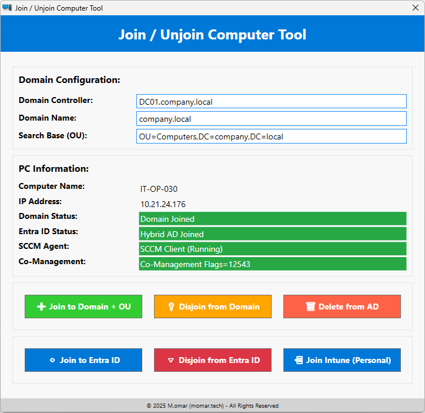
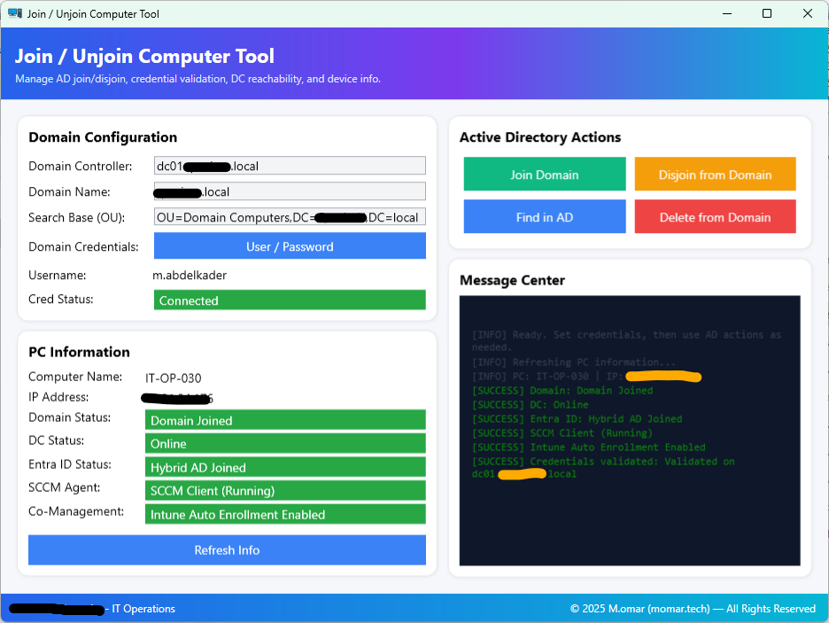

<div align="center">

# 🖥️ Join Unjoin Computer Tool

**WPF GUI for Helpdesk teams to join, disjoin, and clean up computer objects across Active Directory and Microsoft Entra ID.**

Turns complex PowerShell operations into a friendly, color-coded interface for front-line support.

[](#%EF%B8%8F-usage)
[](#%EF%B8%8F-usage)
[](https://learn.microsoft.com/en-us/powershell/)
[](#%EF%B8%8F-requirements)
[](#-license)
[](#-overview)

[Overview](#-overview) • [Features](#-core-features) • [Usage](#%EF%B8%8F-usage) • [Requirements](#%EF%B8%8F-requirements) • [License](#-license)

</div>

---

# 📖 Overview

**Join Unjoin Computer Tool** is a PowerShell WPF GUI built for Helpdesk teams to safely manage computer objects across **Active Directory (AD)** and **Microsoft Entra ID (Azure AD)**. It covers domain join and disjoin (with OU selection), AD object deletion with safeguards, Entra ID join and leave, Intune enrollment, and a live device information snapshot, all with confirmation prompts and color-coded status indicators.

Two builds ship side by side: **v1 (Classic)** and **v2 (Enhanced)** with credential validation, DC reachability checks, and a Message Center log.

### 🖼️ Screenshots



*Main interface v1 (Classic build).*



*Main interface v2 (Enhanced build with Message Center and validation pills).*

---

# ✨ Core Features

### 🔹 Domain Join and Disjoin
* Join a computer to AD with OU picker; disjoin to a workgroup with restart prompt.

### 🔹 AD Object Deletion
* Delete computer objects with validation and double confirmation; warns when the account is still enabled.

### 🔹 Entra ID and Intune
* Join and leave Microsoft Entra ID via `dsregcmd`; detect Intune enrollment as personal device.

### 🔹 Device Information Snapshot
* Domain, IP, Entra ID join state, SCCM client, and Co-Management posture with live refresh.

### 🔹 Helpdesk Safety
* Color-coded status (Active, Inactive, Needs Attention), credential validation pill, and DC reachability check on ports 389 and 88.

### 🔹 Light / Dark Theme
* Full Tailwind Slate token system with instant toggle.

---

# 📂 Project Structure

```text
JoinUnjoinComputerTool-GUI
│
├── JoinUnjoinComputerTool-v1.ps1
├── JoinUnjoinComputerTool-v1.exe
├── JoinUnjoinComputerTool-v2.ps1
├── JoinUnjoinComputerTool-v2.exe
├── Screenshot1.png
├── Screenshot2.png
└── README.md
```

---

# 🚀 Getting Started

### Prerequisites
* Windows 10/11 or Windows Server 2016+
* PowerShell **5.1 or later**
* Must be run as **Administrator**

### Installation
1. Download `JoinUnjoinComputerTool-v1.ps1` or `JoinUnjoinComputerTool-v2.ps1` (v2 recommended).
2. Run from an elevated PowerShell session: `.\JoinUnjoinComputerTool-v2.ps1`
3. Or launch the compiled executable `JoinUnjoinComputerTool-v2.exe` without changing execution policy.

---

# 🖥️ Usage

### Main Window
* Join: select an OU and enter credentials, then join the computer to AD.
* Disjoin: remove the computer from AD and move it to WORKGROUP.
* Delete AD Object: remove the computer account from AD after confirmation.
* Entra ID: join or leave Microsoft Entra ID with the dsregcmd controls.
* Device Info: refresh to view domain, IP, Entra ID, SCCM, and Co-Management status.

### Exit Codes
| Code | Status |
| ---- | ------ |
| 0    | Normal exit after the user closes the window |

---

# ⚙️ Requirements

### Operating System
* Windows 10 / Windows 11 / Windows Server 2016+

### PowerShell
* PowerShell **5.1 or later**

### Permissions
* Administrator privileges.
* AD permissions for computer join, disjoin, and deletion; Entra ID permissions for device registration tasks.

---

## 🧰 Core Commands

The PowerShell cmdlets and tools that drive the GUI operations.

| Command | Purpose | Docs |
|---|---|---|
| `Get-ADComputer` | Locates and inspects computer objects in AD | [Microsoft Docs](https://learn.microsoft.com/en-us/powershell/module/activedirectory/get-adcomputer) |
| `Add-Computer` | Joins the machine to the domain with OU selection | [Microsoft Docs](https://learn.microsoft.com/en-us/powershell/module/microsoft.powershell.management/add-computer) |
| `Remove-Computer` | Disjoins the machine to a workgroup | [Microsoft Docs](https://learn.microsoft.com/en-us/powershell/module/microsoft.powershell.management/remove-computer) |
| `Get-CimInstance` | Reads Win32_ComputerSystem for domain/device state | [Microsoft Docs](https://learn.microsoft.com/en-us/powershell/module/cimcmdlets/get-ciminstance) |
| `dsregcmd` | Joins/leaves Entra ID and reports device join state | [Microsoft Learn](https://learn.microsoft.com/en-us/entra/identity/devices/troubleshoot-device-dsregcmd) |

---

# 🛡 Operational Notes
* Always use **v2** for daily support tasks unless debugging v1.
* Use accounts with **least privilege** (OU join rights only) where possible.
* Confirm before deleting objects from AD; deletion is irreversible.
* If the script fails to launch, run `Set-ExecutionPolicy -Scope Process -ExecutionPolicy Unrestricted -Force` or use the `.exe` build.
* For Entra ID failures, verify network and run `dsregcmd /status` manually; for Co-Management issues, check the `CoManagementFlags` registry key.

---

## 👤 Author

**Mohammad Abdelkader Omar**  
GitHub: [@mabdulkadr](https://github.com/mabdulkadr)  
Website: [momar.tech](https://momar.tech)

---

## 📜 License
This project is licensed under the [MIT License](https://opensource.org/licenses/MIT).

---

## ⚠ Disclaimer

This skill and every script it generates are provided as-is with no warranty of any kind. Test generated tools in a staging environment before deploying to production. The authors assume no liability for any damage or data loss resulting from their use.

---

<div align="center">

⭐ **If this skill saves you time, star the repo — it helps others find it.**

[Report an Issue](../../issues) · [momar.tech](https://momar.tech)

[](https://www.buymeacoffee.com/mabdulkadrx)

Built with [**PowerShell Enterprise Admin**](https://github.com/mabdulkadr/powershell-enterprise-admin-skill)

</div>
